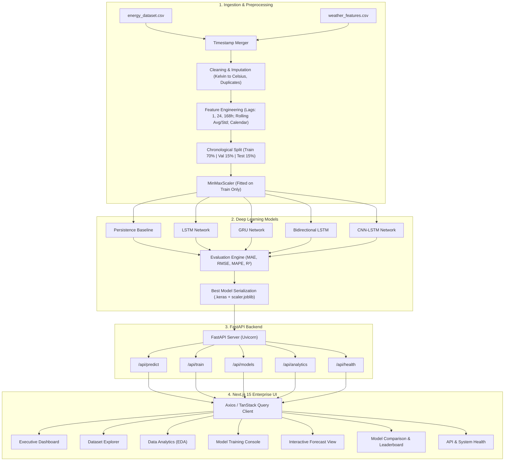

# Project Master Plan: AI-Based Short-Term Load Forecasting for Renewable Integrated Power System (Version 1 - MVP)

**Project Type:** Final Year Engineering Project / Production-Grade ML System  
**Version:** 1.0 (MVP)  
**Author:** AI Technical Lead & Engineering Team  
**Status:** Phase 1 Complete — Pending Approval  

---

## 1. Problem Statement

Modern electrical grids are experiencing an unprecedented integration of renewable energy sources (solar, wind, hydro). While clean and sustainable, renewable energy introduces significant volatility, intermittency, and bidirectional power flows into transmission and distribution networks. 

To maintain grid stability, prevent blackouts, optimize unit commitment, minimize spinning reserves, and balance electricity markets, transmission system operators (TSOs) require highly accurate **Short-Term Load Forecasting (STLF)** (1 hour to 24–168 hours ahead). 

Traditional statistical methods (ARIMA, linear regression) struggle to capture complex non-linear meteorological dependencies, seasonal load shifts, and intra-day behavioral dynamics across regional microclimates. This project addresses this critical challenge by building a production-grade, deep-learning-driven STLF pipeline trained on multi-year hourly grid telemetry and multi-city meteorological data, integrated with a FastAPI microservice and an executive-tier Next.js 15 analytics dashboard.

---

## 2. Project Objectives

### Primary Objective
Develop, benchmark, and deploy an end-to-end deep learning system capable of generating reliable, high-precision short-term electricity load forecasts for a renewable-heavy power system.

### Technical & Engineering Objectives
1. **Multi-Source Data Ingestion & Synthesis:** Aggregate and synchronize multi-year hourly grid load and renewable generation telemetry with multi-city meteorological measurements (Madrid, Barcelona, Valencia, Seville, Bilbao).
2. **Robust Preprocessing & Quality Assurance:** Clean sensor noise, impute missing values, reconcile daylight saving / time-zone discrepancies, convert Kelvin to Celsius, and normalize feature distributions.
3. **Advanced Time-Series Feature Engineering:** Extract rich temporal representations (cyclical calendar features, multi-scale autoregressive lag horizons, rolling window statistical aggregations, and weather interaction vectors).
4. **Deep Learning Sequence Modeling:** Build, train, and validate five comparative architectures under strictly identical temporal splitting conditions:
   - Persistence Baseline (Benchmark)
   - Long Short-Term Memory (LSTM)
   - Gated Recurrent Unit (GRU)
   - Bidirectional LSTM (Bi-LSTM)
   - Hybrid Convolutional-Recurrent Network (CNN-LSTM)
5. **Systematic Model Benchmarking:** Evaluate models using industry-standard power engineering metrics (MAE, RMSE, MAPE, R²) and identify the superior architecture.
6. **Production Microservice:** Expose inference, dataset upload, model training, and telemetry APIs via high-performance FastAPI endpoints with strict Pydantic validation.
7. **Executive Next.js 15 Dashboard:** Deliver an enterprise-grade AI SaaS web application (Next.js App Router, TypeScript, Framer Motion, Tailwind CSS, Dark Theme `#070B14`) providing real-time forecasting, dataset exploration, EDA analytics, interactive model training, and comparison leaderboards.

---

## 3. Functional Requirements (FR)

- **FR-1 (Data Fusion & Alignment):** System must merge `energy_dataset.csv` and `weather_features.csv` on UTC timestamps, handling multi-city weather record aggregation without data duplication.
- **FR-2 (Data Cleaning & Imputation):** System must eliminate duplicate rows, impute missing values using forward-fill / linear interpolation, convert Kelvin temperatures to Celsius, and detect/bound anomalies.
- **FR-3 (Feature Engineering):** System must generate:
  - *Calendar features:* Hour, Day of Week, Month, Day of Year, Is_Weekend.
  - *Lag features:* $t-1$, $t-2$, $t-24$ (daily seasonality), $t-168$ (weekly seasonality).
  - *Rolling aggregates:* Rolling mean and rolling standard deviation over 6-hour, 12-hour, and 24-hour windows.
  - *Weather features:* Temperature, humidity, wind speed, cloud cover, and precipitation.
- **FR-4 (Temporal Train/Validation/Test Split):** Data splitting must be strictly chronological (e.g., 70% Train, 15% Validation, 15% Test) to ensure zero future data leakage.
- **FR-5 (Model Training & Checkpointing):** System must support configurable training (epochs, batch size, learning rate) for LSTM, GRU, Bi-LSTM, and CNN-LSTM models with EarlyStopping and ModelCheckpoint callbacks.
- **FR-6 (Evaluation & Metrics Leaderboard):** System must compute MAE (MW), RMSE (MW), MAPE (%), and $R^2$ on the unseen test set, generating comparative leaderboards and residual plots.
- **FR-7 (FastAPI REST Service):** Backend must provide endpoints:
  - `GET /health` — Service and dependency status.
  - `POST /api/upload` — Ingest new raw or incremental CSV data.
  - `POST /api/train` — Trigger model training with specified parameters.
  - `POST /api/predict` — Return point forecasts for specified horizon ($t+1$ to $t+24$).
  - `GET /api/models` — Retrieve trained models, weights, and leaderboard metrics.
  - `GET /api/analytics` — Serve pre-calculated EDA distributions and correlations.
- **FR-8 (Interactive Dashboard UI):** Next.js frontend must implement 7 distinct screens:
  - *Dashboard:* KPI summary, actual vs. predicted real-time chart, weekly trends.
  - *Dataset Explorer:* Paginated, searchable, filterable data grid with summary statistics.
  - *Data Analytics (EDA):* Heatmaps, load vs. temperature curves, renewable mix.
  - *Model Training:* Live training parameter selector, loss progression curves, training console.
  - *Forecast:* Date/model selector, interactive forecast timeline, CSV export.
  - *Model Comparison:* Metric radar chart, comparative bars, best model badge.
  - *API & System Status:* Endpoint latency, server uptime, model memory footprint.

---

## 4. Non-Functional Requirements (NFR)

- **NFR-1 (Forecasting Accuracy):** The primary deep learning model must achieve a Mean Absolute Percentage Error (MAPE) $< 3.5\%$ on the test set, significantly outperforming the Persistence Baseline.
- **NFR-2 (Inference Latency):** The FastAPI prediction endpoint must return 24-hour load forecasts within $< 150\text{ ms}$ for warm-loaded models.
- **NFR-3 (Data Integrity & Reproducibility):** Scalers (`MinMaxScaler`/`StandardScaler`) must be fitted *only* on the training split and serialized for test and runtime inference. Fixed random seeds (e.g., `seed=42`) must ensure deterministic reproducibility.
- **NFR-4 (System Modularity & Clean Architecture):** Codebase must separate data ingestion, feature transformations, model definitions, REST controllers, and UI components into independent, testable modules.
- **NFR-5 (UI/UX Excellence):** Frontend must render at 60 FPS, utilize a cohesive dark mode palette (`#070B14`, `#111827`, `#161E2E`, `#3B82F6`, `#22D3EE`), provide skeleton loaders for async states, and support responsive viewports.
- **NFR-6 (Security & Input Validation):** All incoming API payloads must be validated using Pydantic schemas; uploaded files must be verified for MIME type and column structure.

---

## 5. Software Requirements

| Category | Component / Tool | Version / Specification | Purpose |
| :--- | :--- | :--- | :--- |
| **Runtime Environment** | Python | 3.10+ | Core ML & Backend runtime |
| **Package Manager** | pip / venv | Latest | Python dependency management |
| **Deep Learning Framework** | TensorFlow / Keras | 2.15+ | Neural sequence model training & export |
| **Data Manipulation** | Pandas, NumPy | Latest stable | High-performance tabular data processing |
| **Machine Learning** | Scikit-learn, SciPy | Latest stable | Normalization, metrics calculation, baselines |
| **Backend Framework** | FastAPI | 0.110+ | High-performance asynchronous REST API |
| **ASGI Web Server** | Uvicorn | Latest | Production-grade ASGI HTTP server |
| **Data Serialization** | Joblib / Pickle / H5 | Standard | Serializing scalers, feature column maps, models |
| **Node.js Runtime** | Node.js | 18.x / 20.x LTS | Next.js build and development runtime |
| **Package Manager** | npm / pnpm | Latest | JavaScript ecosystem package management |
| **Frontend Framework** | Next.js (App Router) | 15.x | Server/Client components, SSR, dynamic routing |
| **Language** | TypeScript | 5.x | End-to-end type safety |
| **CSS Styling** | Tailwind CSS | 3.4+ / 4.x | Utility-first styling & custom design tokens |
| **UI Component Primitives** | Radix UI / Lucide Icons | Latest | Accessible primitives and vector iconography |
| **Animations** | Framer Motion | 11.x | Micro-interactions, transitions, count-ups |
| **Data Visualization** | Recharts / Chart.js | Latest | High-fidelity financial/scientific charts |
| **State & Data Fetching** | TanStack Query & Zustand | Latest | Asynchronous server state & local UI state |
| **HTTP Client** | Axios | Latest | Typed API requests to FastAPI backend |

---

## 6. Hardware Requirements

### Minimum Development & Inference Environment
- **Processor:** Intel Core i5 (8th Gen+) / AMD Ryzen 5 (3000 series+)
- **System Memory (RAM):** 8 GB DDR4
- **Storage:** 10 GB free space (SSD recommended)
- **GPU:** Integrated Graphics (CPU-only training with small batch sizes/epochs)

### Recommended Deep Learning Training Environment
- **Processor:** 8+ Core Intel Core i7/i9 or AMD Ryzen 7/9
- **System Memory (RAM):** 16 GB to 32 GB DDR4/DDR5
- **Storage:** NVMe M.2 SSD with 25 GB free space
- **Discrete GPU:** NVIDIA GeForce RTX 3060 / 4060 or higher (CUDA 12.x, cuDNN, 6+ GB VRAM) for accelerated matrix operations.

---

## 7. Technology Stack & Architectural Justification

```
+-------------------------------------------------------------------------+
|                         PRESENTATION LAYER                              |
|   Next.js 15 (App Router) | TypeScript | Tailwind CSS | Framer Motion   |
|   Lucide Icons | Recharts / Chart.js | TanStack Query | Zustand          |
+-------------------------------------------------------------------------+
                                    ▲
                                    │ HTTP / JSON REST APIs (Axios)
                                    ▼
+-------------------------------------------------------------------------+
|                          API & SERVICE LAYER                            |
|       FastAPI (Async Python 3.10+) | Uvicorn ASGI | Pydantic v2         |
|   Endpoints: /api/predict, /api/train, /api/upload, /api/analytics     |
+-------------------------------------------------------------------------+
                                    ▲
                                    │ Model Invocation & In-Memory Pipeline
                                    ▼
+-------------------------------------------------------------------------+
|                         ML & INFERENCE CORE                             |
|  TensorFlow/Keras (LSTM, GRU, Bi-LSTM, CNN-LSTM) | Scikit-Learn Scalers |
|  Joblib Metadata Artifacts | In-Memory Sliding Window Generator         |
+-------------------------------------------------------------------------+
                                    ▲
                                    │ Feature Matrices (Parquet / HDF5 / CSV)
                                    ▼
+-------------------------------------------------------------------------+
|                      DATA INGESTION & PIPELINE                          |
|  Pandas | NumPy | Time-Series Featurizer | Imputer | Multi-City Sync    |
|  Raw Datasets: energy_dataset.csv & weather_features.csv (5 Cities)     |
+-------------------------------------------------------------------------+
```

### Justification of Core Choices
1. **FastAPI vs Flask/Django:** FastAPI offers asynchronous ASGI capabilities, native Pydantic schema validation, automatic OpenAPI / Swagger documentation, and near-Go performance, making it the premier choice for ML microservices.
2. **Next.js 15 vs Streamlit:** Streamlit re-executes the entire script on state changes, lacks customizable modern SaaS design tokens, and cannot deliver commercial portfolio-grade UX. Next.js 15 with App Router enables instant client-side transitions, modular components, and fluid animations.
3. **TensorFlow / Keras for Recurrent Networks:** Native support for cuDNN-accelerated LSTM/GRU kernels, stable model serialization formats (`.keras`), and seamless evaluation callbacks.

---

## 8. High-Level Architecture Diagram



---

## 9. Modular Folder Structure

```
project/
│
├── archive (1)/                        # Raw source datasets
│   ├── energy_dataset.csv              # Hourly Spanish electrical grid telemetry
│   └── weather_features.csv            # Hourly weather data for 5 cities
│
├── data/                               # Processed dataset storage
│   ├── raw/                            # Ingested immutable raw data copies
│   ├── processed/                      # Merged, cleaned, and standardized datasets
│   └── features/                       # Normalized feature matrices and sequences
│
├── backend/                            # FastAPI Application
│   ├── app/
│   │   ├── __init__.py
│   │   ├── main.py                     # FastAPI entrypoint and middleware
│   │   ├── config.py                   # Environment settings & hyperparameter configs
│   │   ├── api/
│   │   │   ├── __init__.py
│   │   │   ├── routes.py               # API route definitions
│   │   │   └── schemas.py              # Pydantic request/response models
│   │   ├── services/
│   │   │   ├── __init__.py
│   │   │   ├── data_service.py         # Ingestion, merging & stats service
│   │   │   ├── feature_service.py      # Transformations, lag generation, scaling
│   │   │   ├── model_service.py        # Model training, checkpointing & selection
│   │   │   └── prediction_service.py   # Sliding window inference engine
│   │   └── utils/
│   │       ├── __init__.py
│   │       ├── logger.py               # Structured logging
│   │       └── metrics.py              # MAE, RMSE, MAPE, R2 calculations
│   ├── models/                         # Serialized weights (.keras)
│   ├── artifacts/                      # Scalers (scaler.joblib), feature lists (json)
│   ├── requirements.txt                # Backend Python dependencies
│   └── tests/                          # Unit & integration tests
│
├── frontend/                           # Next.js 15 App Router Frontend
│   ├── app/
│   │   ├── layout.tsx                  # Root layout (Dark theme, fonts, sidebar)
│   │   ├── page.tsx                    # Executive Dashboard overview
│   │   ├── dataset/page.tsx            # Dataset Explorer
│   │   ├── analytics/page.tsx          # EDA & Meteorological Analysis
│   │   ├── training/page.tsx           # Model Training Studio
│   │   ├── forecast/page.tsx           # Interactive Prediction & Horizon View
│   │   ├── models/page.tsx             # Benchmark Comparison & Leaderboard
│   │   └── status/page.tsx             # API & System Telemetry
│   ├── components/                     # Reusable UI component library
│   │   ├── layout/                     # Sidebar, Navbar, PageHeader, Container
│   │   ├── ui/                         # Cards, Buttons, Badges, Modals, Tables, Skeletons
│   │   ├── charts/                     # Recharts wrappers (Time-series, Heatmaps, Bars)
│   │   └── forms/                      # Sliders, Inputs, Selectors, Toggles
│   ├── hooks/                          # Custom React hooks (useForecast, useTraining)
│   ├── services/                       # Typed Axios API client methods
│   ├── types/                          # TypeScript interfaces & DTOs
│   ├── lib/                            # Utility functions (cn, formatters)
│   ├── styles/                         # Global Tailwind directives & color tokens
│   ├── public/                         # Static assets and icons
│   ├── package.json                    # Node dependencies
│   ├── tsconfig.json                   # TypeScript configuration
│   └── tailwind.config.ts              # Custom design tokens & dark theme palette
│
└── docs/                               # Engineering documentation & reports
    ├── PROJECT_PLAN.md                 # Complete Master Specification
    └── data_quality_report.md          # Generated during Phase 2
```

---

## 10. Development Timeline & Milestone Breakdown

| Phase | Milestone Name | Key Deliverables & Validation Criteria | Target Status |
| :---: | :--- | :--- | :---: |
| **Phase 1** | **Project Planning** | Master Plan document, architecture diagrams, requirements specification, directory layout. | **Completed (Current)** |
| **Phase 2** | **Data Collection & Understanding** | Load raw datasets, schema validation, data types, missing/duplicate audits, city reconciliation, Data Quality Report. | Pending Approval |
| **Phase 3** | **Data Cleaning** | Handle nulls, remove duplicates, convert Kelvin to Celsius, aggregate 5-city weather, detect outliers, save `cleaned_dataset.csv`. | Planned |
| **Phase 4** | **Exploratory Data Analysis (EDA)** | Load profiles, daily/weekly/seasonal periodicity, correlation heatmap, temperature vs. load elasticity, renewable mix charts. | Planned |
| **Phase 5** | **Feature Engineering** | Calendar features, multi-scale lag features ($t-1$, $24$, $168$), rolling window statistics, weather features, temporal split, scaling. | Planned |
| **Phase 6** | **Model Development** | Implement and train Persistence Baseline, LSTM, GRU, Bi-LSTM, and CNN-LSTM models with callbacks. Save `.keras` models. | Planned |
| **Phase 7** | **Model Evaluation & Selection** | Compute MAE, RMSE, MAPE, $R^2$. Generate performance leaderboard, residual error curves, select and persist best production model. | Planned |
| **Phase 8** | **Backend Development (FastAPI)** | Develop REST endpoints (`/upload`, `/train`, `/predict`, `/models`, `/health`), write Pydantic schemas, integrate model inference. | Planned |
| **Phase 9** | **Dashboard Frontend (Next.js 15)** | Build 7 enterprise pages, dark theme `#070B14`, Framer Motion animations, Recharts analytics, API integration, end-to-end testing. | Planned |

---
*Ready for Phase 1 review and formal sign-off before commencing Phase 2.*
