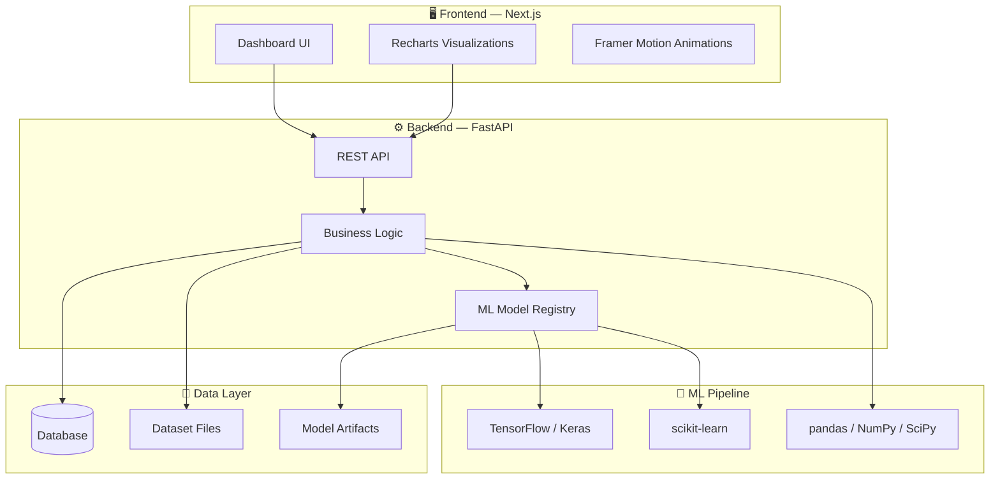

<div align="center">

# ⚡ GridPulse AI

### Intelligent Short-Term Electricity Load Forecasting Platform

[](https://python.org)
[](https://nextjs.org)
[](https://fastapi.tiangolo.com)
[](https://tensorflow.org)
[](LICENSE)

<br/>

*A full-stack AI-powered platform for renewable-integrated power systems that combines deep learning forecasting with a modern analytics dashboard.*

<br/>

---

</div>

## 🎯 Overview

**GridPulse AI** is an end-to-end electricity load forecasting platform designed for renewable-integrated power grids. It pairs a sleek **Next.js analytics dashboard** with a high-performance **FastAPI backend** — enabling real-time forecasting, dataset exploration, model evaluation, training pipelines, and CSV-based data analysis.

> [!NOTE]
> Some enterprise-style views use illustrative or simulated values. Treat their displayed telemetry and scenario outputs as examples unless connected to a live, validated data source.

<br/>

## ✨ Key Features

<table>
<tr>
<td width="50%">

### 📊 Operations Dashboard
Real-time load & forecast summaries, interactive forecast charts, and live model status monitoring.

### 🔮 Forecasting & Analytics
Multi-horizon forecasting with historical pattern analysis and comprehensive model performance metrics.

### 📁 Dataset Explorer
Summary statistics, paginated data views, and deep dataset introspection tools.

</td>
<td width="50%">

### 📤 Upload & Analyze
CSV profiling, automated data quality checks, time-series diagnostics, and report management.

### 🏋️ Model Training
End-to-end training pipelines with benchmarking across multiple forecasting architectures.

### 🧠 Grid Intelligence
Explainability views, what-if simulations, decision support, digital twin visualization, and operational monitoring.

</td>
</tr>
</table>

<br/>

## 🏗️ Architecture



<br/>

## 🛠️ Tech Stack

| Layer | Technologies |
|:------|:-------------|
| **Frontend** | Next.js 15 (App Router) · React · TypeScript · Tailwind CSS · Framer Motion · Recharts · Lucide Icons |
| **Backend** | Python · FastAPI · Pydantic · Uvicorn · Alembic |
| **ML & Data** | TensorFlow / Keras · scikit-learn · pandas · NumPy · SciPy |
| **DevOps** | pytest · Ruff · TypeScript strict mode |

<br/>

## 📋 Prerequisites

- **Python** 3.10 or newer
- **Node.js** 18+ and npm
- Python dependencies listed in `backend/requirements.txt`

> [!IMPORTANT]
> TensorFlow installation support varies by Python version and OS. If installation fails, consult the [TensorFlow install guide](https://www.tensorflow.org/install) for compatibility.

<br/>

## 🚀 Quick Start

### 1️⃣ Clone the Repository

```bash
git clone https://github.com/ambuujjj/GridPluse-AI.git
cd GridPluse-AI
```

### 2️⃣ Start the Backend API

<details>
<summary>🪟 <b>Windows (PowerShell)</b></summary>

```powershell
cd backend
python -m venv .venv
.\.venv\Scripts\Activate.ps1
python -m pip install -r requirements.txt
python -m uvicorn app.main:app --reload --host 127.0.0.1 --port 8000
```

</details>

<details>
<summary> <b>macOS / Linux</b></summary>

```bash
cd backend
python3 -m venv .venv
source .venv/bin/activate
python -m pip install -r requirements.txt
python -m uvicorn app.main:app --reload --host 127.0.0.1 --port 8000
```

</details>

> **Health Check:** [`http://127.0.0.1:8000/health`](http://127.0.0.1:8000/health)
> **API Docs:** [`http://127.0.0.1:8000/docs`](http://127.0.0.1:8000/docs)

### 3️⃣ Start the Frontend Dashboard

```bash
cd frontend
npm install
npm run dev
```

Open [`http://localhost:3000`](http://localhost:3000) in your browser.

<details>
<summary>⚙️ <b>Custom API Host Configuration</b></summary>

Create `frontend/.env.local` and set:

```env
NEXT_PUBLIC_API_URL=http://127.0.0.1:8000
```

Restart the frontend after changing this value.

</details>

<br/>

## 📡 API Reference

| Method | Endpoint | Description |
|:------:|:---------|:------------|
| `GET` | `/health` | API and model availability status |
| `GET` | `/api/models` | Model leaderboard and registry |
| `POST` | `/api/predict` | Generate a load forecast |
| `GET` | `/api/analytics` | Retrieve analytics summaries |
| `GET` | `/api/dataset/stats` | Dataset summary statistics |
| `GET` | `/api/dataset` | Paginated dataset view |
| `POST` | `/api/train` | Initiate model training |
| `POST` | `/api/upload-analyze` | Upload and profile a CSV dataset |
| `GET` | `/api/reports` | List saved upload reports |

> [!TIP]
> Visit `/docs` on the running API for the full interactive Swagger documentation with request schemas and parameters.

<br/>

## 🧪 Testing

```bash
# Run Python test suite
python -m pytest

# Frontend TypeScript check
cd frontend && npx tsc --noEmit
```

<br/>

## 📂 Project Structure

```
GridPulse-AI/
├── 🔧 backend/          # FastAPI application, services, schemas & model integration
├── 🖥️ frontend/          # Next.js dashboard, components & API client
├── 📦 src/               # GridSight Python package (core library)
├── 🧪 tests/             # Python test suite
├── ⚙️ configs/           # Project configuration files
├── 📊 data/              # Local datasets & generated analysis artifacts
├── 📚 docs/              # Project documentation
├── 🔨 scripts/           # Utility and data workflow scripts
├── 📄 alembic.ini        # Database migration configuration
├── 📄 pyproject.toml     # Python project metadata
└── 📄 README.md          # You are here!
```

<br/>

## ⚠️ Data & Security Notes

> [!CAUTION]
> - The `.gitignore` excludes generated/large data files. A fresh clone may not include trained models, scalers, or datasets.
> - Add required data files to the configured backend locations before using data-dependent endpoints.
> - Do **not** upload sensitive or regulated data without proper authorization and access controls.

<br/>

---

<div align="center">

**Built with ❤️ for the future of smart energy**

⚡ GridPulse AI — *Powering Predictions for a Renewable World*

</div>
